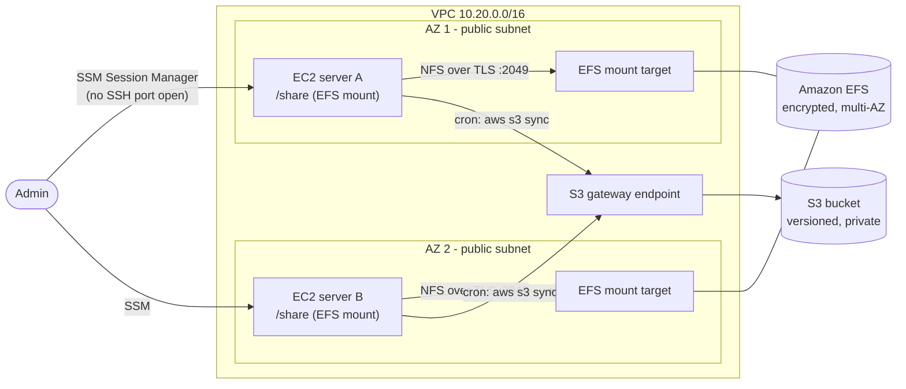

# High-Availability File Sharing with EC2, EFS & S3 Auto-Sync

Two Amazon Linux 2023 servers in **different Availability Zones** share one encrypted
**Amazon EFS** file system. Anything saved to `/share/projects` on either server is visible
on the other right away, and a cron job copies it to a **private, versioned S3 bucket**
every 5 minutes as an off-server backup.

The whole environment (VPC, subnets, NACLs, security groups, IAM, EFS, S3, EC2) is one
CloudFormation template.

## Architecture



| Component | Purpose |
|-----------|---------|
| VPC + 2 public subnets | One subnet per AZ, so losing an AZ leaves one server running |
| Amazon EFS | Shared, regional file system with a mount target in each AZ |
| EC2 x2 (launch template) | File servers; IMDSv2 only, encrypted gp3 root volume |
| cron + `efs-s3-sync.sh` | Uploads new and changed files from `/share/projects` to S3 |
| S3 bucket | Backup copy, versioned, old versions expire after 30 days |
| S3 gateway endpoint | Keeps sync traffic on the AWS network (no extra cost) |

## Security measures

- **No inbound ports.** The server security group has no inbound rules. Admin access is through
  **SSM Session Manager**, so there is no SSH key to manage and no port 22 exposed.
- **EFS is locked down three ways:**
  - Its security group only accepts NFS (TCP 2049) from the server security group.
  - Its file system policy only allows the servers' IAM role, through a mount target.
  - The same policy denies any connection that isn't encrypted in transit. Clients mount with `tls,iam`.
- **IAM least privilege.** The instance role can list and upload only under `projects/` in
  the bucket. It can't read or delete objects, so a compromised server can't wipe the backups.
- **S3 hardening.** Block Public Access (all four settings), SSE-S3 encryption, bucket-owner-enforced
  ownership, versioning, and a bucket policy that denies non-HTTPS requests.
- **Network ACL** as a second, stateless layer: it allows VPC traffic and return traffic only.
- **Encryption at rest everywhere:** EFS, EBS and S3.

## Repository layout

```
infrastructure/template.yaml       CloudFormation template (the complete environment)
scripts/efs-s3-sync.sh             Sync script installed on both servers by UserData
config/efs-s3-sync.conf.example    Format of the config file the script reads
```

## Deploy

Prerequisites: AWS CLI v2 configured for your account and the Session Manager plugin
(only needed for the CLI `start-session` command; the console works without it).

```bash
aws cloudformation deploy \
  --stack-name ha-file-share \
  --template-file infrastructure/template.yaml \
  --capabilities CAPABILITY_IAM

aws cloudformation describe-stacks --stack-name ha-file-share \
  --query "Stacks[0].Outputs" --output table
```

## Test it

1. **Write on server A:**
   ```bash
   aws ssm start-session --target <FileServerAId>
   echo "hello from server A - $(date)" | sudo tee /share/projects/hello.txt
   ```
2. **Read on server B** (proves the storage is shared):
   ```bash
   aws ssm start-session --target <FileServerBId>
   cat /share/projects/hello.txt
   ```
3. **Check the S3 backup** after the next sync (up to 5 minutes), or run the sync by hand:
   ```bash
   sudo /usr/local/bin/efs-s3-sync.sh && tail /var/log/efs-s3-sync.log
   aws s3 ls s3://<BackupBucketName>/projects/
   ```
4. **Simulate an AZ failure:** stop server A in the console. Server B still has every file
   and keeps syncing to S3.

## Clean up

```bash
aws cloudformation delete-stack --stack-name ha-file-share
```

The S3 bucket is **retained** on purpose so backups survive stack deletion. If you don't need
it, empty it (S3 console -> bucket -> **Empty**, which also removes old versions) and delete it.

## Cost notes

Two `t3.micro` instances, a few MB in EFS and S3, and a free gateway endpoint. No NAT gateway
and no load balancer. Delete the stack when you're done so you aren't charged for idle instances.

## What I'd change for production

- Put the servers in private subnets behind a NAT gateway, or use VPC interface endpoints for SSM
- Turn on AWS Backup for EFS and S3 Cross-Region Replication for disaster recovery
- Run the servers in an Auto Scaling group so a failed instance is replaced automatically
- Send `/var/log/efs-s3-sync.log` to CloudWatch Logs and alarm on sync errors

## Skills demonstrated

`Amazon EC2` `Amazon EFS` `Amazon S3` `Amazon VPC` `IAM` `NACLs` `Security Groups`
`Systems Manager` `CloudFormation` `Bash` `cron` `Linux`
